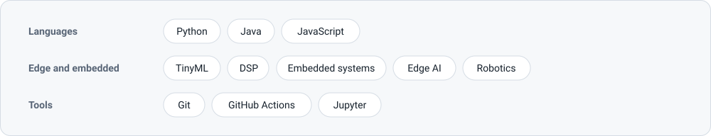
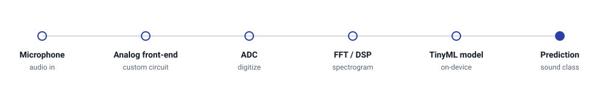

  <picture>
    <source media="(prefers-color-scheme: dark)" srcset="assets/header-dark.svg">
    
  </picture>

  
  
  <!-- Add these when ready:
  
  
  -->

## About

I build software that runs close to the hardware: capturing a signal, processing it, and running a model on a small device. I work on teams with **Dallas Formula Racing** and **FTC Robotics**, and I keep my fundamentals sharp in [algorithm-lab](https://github.com/Keen2640/algorithm-lab).

I'm looking for a software engineering internship where I can ship real code on a team.

  <picture>
    <source media="(prefers-color-scheme: dark)" srcset="assets/skills-dark.svg">
    
  </picture>

## Featured project: Low-Power Edge AI Acoustic Classifier

A real-time sound classifier that runs entirely on-device. A custom analog front-end captures audio, an FFT pipeline turns it into spectrograms, and a TinyML model classifies it without a network connection.

  <a href="https://github.com/Keen2640/Low-Power-Edge-AI-Acoustic-Classifier">
    <picture>
    <source media="(prefers-color-scheme: dark)" srcset="assets/pipeline-dark.svg">
    
  </picture>
  </a>

- Hardware to model: analog capture, DSP, and inference in one system
- Built with Python, Jupyter, TinyML and embedded tooling
<!-- Add real numbers here if you have them, for example accuracy, model size, latency, power draw -->

[View the repository](https://github.com/Keen2640/Low-Power-Edge-AI-Acoustic-Classifier)

## Other projects

| Project | What it is | Stack |
| --- | --- | --- |
| [AIOS](https://github.com/Keen2640/AIOS) | <!-- one sentence --> | Python |
| [jobfit](https://github.com/Keen2640/jobfit) | <!-- one sentence --> | Python |
| [algorithm-lab](https://github.com/Keen2640/algorithm-lab) | Algorithm experiments and implementations | JavaScript |
| [Dallas Formula Racing: Onboarding](https://github.com/DallasFormulaRacing/Onboarding) | Software onboarding project for the race team | Python |
| [FTC Robot Code](https://github.com/Keen2640/FTC-Robot-Code) | Robot control code for FIRST Tech Challenge | Java |
| [Fall 2025 Game Jam](https://github.com/Keen2640/fall-2025-game-jam-upload) | Game jam entry | Game jam |
