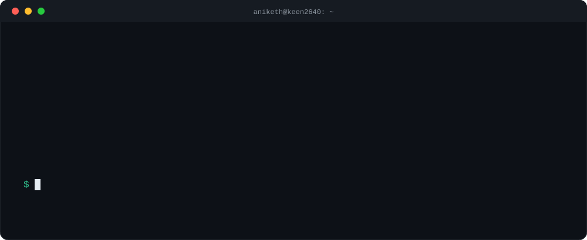
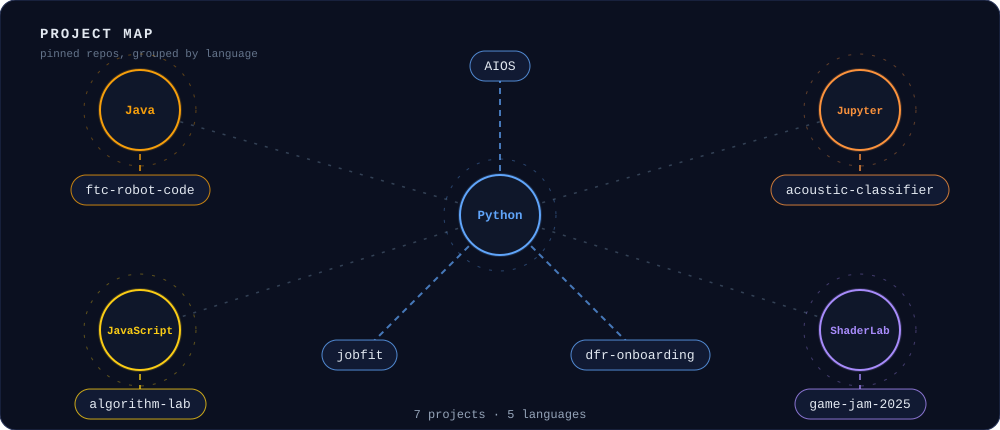
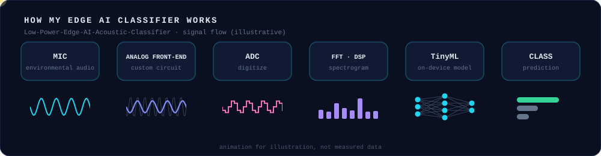
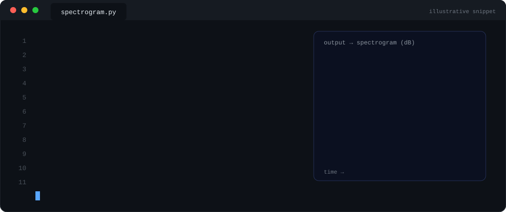
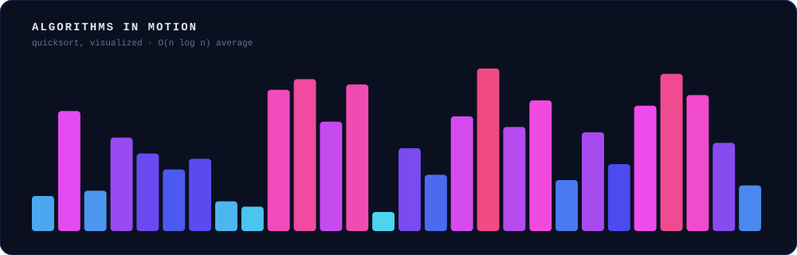

  

  

  
  

---

  

### 🗺️ What I've built

  

### ⚡ Featured: Edge AI acoustic classifier

  

  

### 🧠 Algorithms

  

### 🧑‍💻 How I build software

- **End to end:** I take a system from the hardware up, including signal capture, DSP and the ML model, and ship it as working code.
- **On a team:** I contribute to real team codebases with Dallas Formula Racing and FTC Robotics, not just solo projects.
- **Fundamentals:** I work on algorithms in [algorithm-lab](https://github.com/Keen2640/algorithm-lab).
- **Automation:** this profile is built with Git and a scheduled GitHub Actions workflow.

### 🚀 Projects

<table>
  <tr>
    <td width="50%">
      <h4><a href="https://github.com/Keen2640/Low-Power-Edge-AI-Acoustic-Classifier">Low-Power Edge AI Acoustic Classifier</a></h4>
      Real-time acoustic classifier using TinyML, DSP and embedded systems. A custom analog front-end captures environmental audio, FFT-based DSP generates spectrograms, and the model runs on-device.  
      
      
      
    </td>
    <td width="50%">
      <h4><a href="https://github.com/Keen2640/AIOS">AIOS</a></h4>
      
    </td>
  </tr>
  <tr>
    <td width="50%">
      <h4><a href="https://github.com/Keen2640/jobfit">jobfit</a></h4>
      
    </td>
    <td width="50%">
      <h4><a href="https://github.com/Keen2640/algorithm-lab">algorithm-lab</a></h4>
      Algorithm experiments and implementations.  
      
    </td>
  </tr>
  <tr>
    <td width="50%">
      <h4><a href="https://github.com/DallasFormulaRacing/Onboarding">Dallas Formula Racing: Onboarding</a></h4>
      Software onboarding project for the Dallas Formula Racing team.  
      
    </td>
    <td width="50%">
      <h4><a href="https://github.com/Keen2640/FTC-Robot-Code">FTC Robot Code</a></h4>
      Robot control code for FIRST Tech Challenge.  
      
    </td>
  </tr>
</table>

Also: [Fall 2025 game jam entry](https://github.com/Keen2640/fall-2025-game-jam-upload)

### 📊 GitHub stats

  
  

### 🐍 Contribution snake

  <picture>
    <source media="(prefers-color-scheme: dark)" srcset="https://raw.githubusercontent.com/Keen2640/Keen2640/output/github-snake-dark.svg"/>
    
  </picture>

