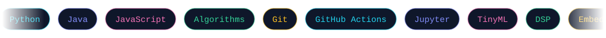
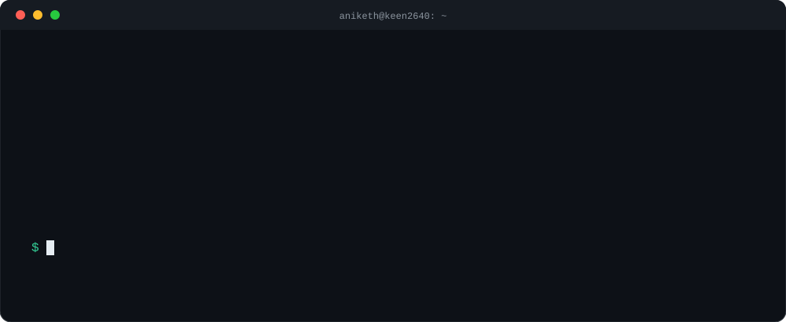
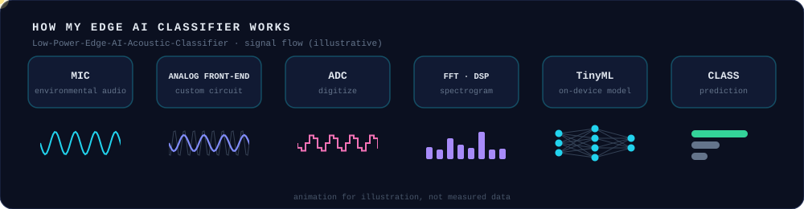
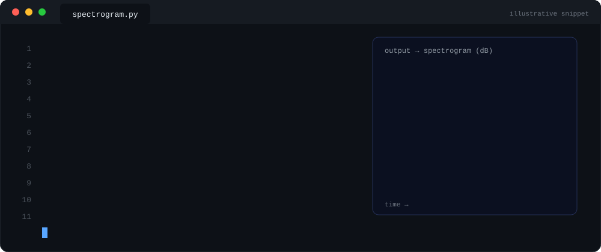
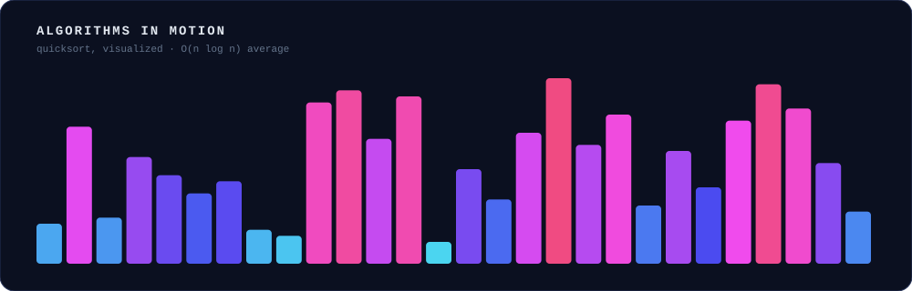

  

  

  
  
  <!-- Add your LinkedIn and resume links here:
  
  
  -->

---

  

## About

Software engineer focused on **Edge AI and embedded systems**. I build systems end to end: signal capture, DSP, and an ML model that runs on-device. I also contribute to team codebases with **Dallas Formula Racing** and **FTC Robotics**, and practice core algorithms in [algorithm-lab](https://github.com/Keen2640/algorithm-lab).

**Currently:** building low-power ML that runs on tiny hardware.
**Looking for:** Software Engineering internships.

## Featured project

### Low-Power Edge AI Acoustic Classifier

Real-time acoustic classifier built with TinyML, DSP and embedded systems. A custom analog front-end captures environmental audio, an FFT-based pipeline generates spectrograms, and the model runs on-device.

  

  

<a href="https://github.com/Keen2640/Low-Power-Edge-AI-Acoustic-Classifier"><b>View the repository →</b></a>

## More projects

<table>
  <tr>
    <td width="50%" valign="top">
      <h4><a href="https://github.com/Keen2640/AIOS">AIOS</a></h4>
      <!-- TODO: one sentence on what AIOS does -->
      
    </td>
    <td width="50%" valign="top">
      <h4><a href="https://github.com/Keen2640/jobfit">jobfit</a></h4>
      <!-- TODO: one sentence on what jobfit does -->
      
    </td>
  </tr>
  <tr>
    <td width="50%" valign="top">
      <h4><a href="https://github.com/Keen2640/algorithm-lab">algorithm-lab</a></h4>
      Algorithm experiments and implementations.  
      
    </td>
    <td width="50%" valign="top">
      <h4><a href="https://github.com/DallasFormulaRacing/Onboarding">Dallas Formula Racing: Onboarding</a></h4>
      Software onboarding project for the Dallas Formula Racing team.  
      
    </td>
  </tr>
  <tr>
    <td width="50%" valign="top">
      <h4><a href="https://github.com/Keen2640/FTC-Robot-Code">FTC Robot Code</a></h4>
      Robot control code for FIRST Tech Challenge.  
      
    </td>
    <td width="50%" valign="top">
      <h4><a href="https://github.com/Keen2640/fall-2025-game-jam-upload">Fall 2025 Game Jam</a></h4>
      Game jam entry.  
      
    </td>
  </tr>
</table>

## Algorithms

  

## Languages

  

