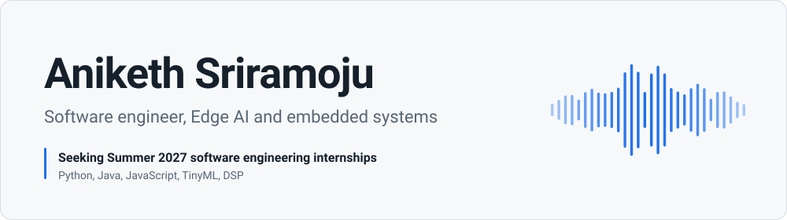
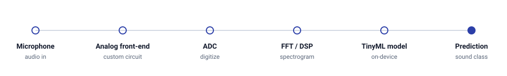

<picture>
    <source media="(prefers-color-scheme: dark)" srcset="assets/header-dark.svg">
    
  </picture>

[Email](mailto:anikethsriramoju@gmail.com) &nbsp;/&nbsp; [LinkedIn](https://www.linkedin.com/in/aniketh-sriramoju-75b46528b) &nbsp;/&nbsp; [GitHub](https://github.com/Keen2640?tab=repositories)

The banner above is a spectrogram (sound over time and frequency) drawn as a 3D terrain. It is the kind of signal my classifier works on.

## About

I like software that has to be right about something real: a physical signal that has to be classified on a chip with almost no power or memory, or a risk number that has to hold up when interest rates move. I'm a Computer Science student at UT Dallas (graduating May 2028).

I'm part of **Nebula Labs**, **AIS**, and **Dallas Formula Racing**.

## Featured projects

### [Surplus: Pension LDI & Funded-Status Risk Engine](https://github.com/Keen2640/surplus)

A liability-driven investing engine for a corporate pension plan, built on real data (the U.S. Treasury yield curve and SSA mortality tables). It values the plan's liabilities, measures their interest-rate risk, builds a hedge out of Treasury bonds and swaps, and stress-tests investment strategies across 10,000 simulated interest-rate paths.

- Values a 20,000-participant plan ($1.79B) with a Nelson-Siegel-Svensson curve fit to within 1.5bp of observed Treasury yields
- Optimizes a STRIPS, bond and swap hedge to a 90% hedge ratio within 3.4% key-rate mismatch
- Hull-White simulation, sampled exactly and checked against the curve: the 90% hedge cuts rate-driven surplus VaR by 93% vs. a traditional 60/40 portfolio
- A Claude tool-calling analyst whose every number is audited against engine output, a FastAPI dashboard, and 20 tests against closed-form results

**Stack:** Python, NumPy, SciPy, FastAPI, Claude API, Chart.js

### [Low-Power Edge AI Acoustic Classifier](https://github.com/Keen2640/Low-Power-Edge-AI-Acoustic-Classifier)

A sound classifier that runs entirely on the device, with no network connection. I built the analog front-end that captures audio, the FFT pipeline that turns it into spectrograms, and the TinyML model that classifies them.

<picture>
    <source media="(prefers-color-scheme: dark)" srcset="assets/pipeline-dark.svg">
    
  </picture>

- 79.4% test accuracy from a 15.15 KB CNN that fits an ESP32's 32 KB flash and 16 KB RAM budget
- INT8 quantization cut model size 4x, and the input was shrunk 75% (64x64 to 32x32) before export as a C header

**Stack:** Python, TensorFlow Lite, C, ESP32, DSP

## Other work

| Project | What it is |
| --- | --- |
| [AIOS](https://github.com/Keen2640/AIOS) | Agent runtime that turns plain-English requests into validated, executable actions on a local machine (Python, Gemini) |
| [jobfit](https://github.com/Keen2640/jobfit) | Job-posting classifier and resume ranker: 87% accuracy on 41K postings, served from a Dockerized FastAPI API (Python, PostgreSQL, XGBoost) |
| [algorithm-lab](https://github.com/Keen2640/algorithm-lab) | Algorithm implementations and experiments (JavaScript) |
| [Fall 2025 Game Jam](https://github.com/Keen2640/fall-2025-game-jam-upload) | Game built for the Fall 2025 game jam |
| [Dallas Formula Racing: Onboarding](https://github.com/DallasFormulaRacing/Onboarding) | Software onboarding project for the university race team (Python) |

## Skills

**Languages:** Python, SQL, C/C++, Java, JavaScript/TypeScript  
**Focus:** edge AI and TinyML, DSP, quantitative risk modeling, ML serving, LLM agents  
**Tools:** NumPy, SciPy, PyTorch, scikit-learn, XGBoost, FastAPI, Docker, PostgreSQL, Git, GitHub Actions
